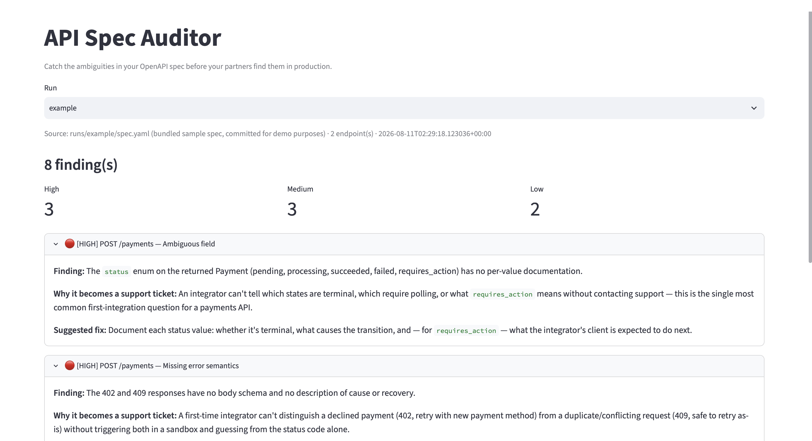

# API Spec Auditor

**Catch the ambiguities in your OpenAPI spec before your partners find them in production.**

<!-- TODO: replace with a GIF of the tool running -->


---

## The problem

Onboarding a partner onto a new API routinely takes weeks, and much of that goes to answering questions the spec should have answered. What does `status: "pending"` actually mean? What happens on a 409? Is `merchant_id` required or just usually present?

Every one of those questions is a spec defect that shipped. They're expensive because they surface late — after the partner has already started integrating, when the fix means a breaking change or a support ticket.

Schema linters catch structural violations. They don't catch ambiguity, and ambiguity is what costs the weeks.

## What this does

Point it at an OpenAPI spec. It returns a prioritized list of the things a first-time integrator will get wrong:

- **Ambiguous fields** — enums without documented meaning, optional fields that are effectively required, names that imply behavior the spec doesn't confirm
- **Missing error semantics** — documented status codes with no explanation of cause or recovery, undocumented failure modes for operations that clearly have them
- **Breaking-change risk** — fields and patterns likely to need revision, flagged before v1 ships
- **Integration blind spots** — a simulated first-time consumer walks a core flow and reports where it got stuck

Each finding includes the endpoint, why it will cause a support ticket, and a suggested fix.

## Quickstart

This is a two-step flow: a CLI script prepares the audit, then Claude Code runs the analysis, then the Streamlit app displays it. No Anthropic API key needed — analysis runs through [Claude Code](https://claude.com/claude-code) on your existing Claude Pro/Max subscription, not metered API access.

```bash
git clone https://github.com/YOUR_USERNAME/payments-agents.git
cd payments-agents/api-spec-auditor
python3 -m venv venv && source venv/bin/activate
pip install -r requirements.txt

# 1. Parse the spec and write analysis requests
python audit.py https://raw.githubusercontent.com/stripe/openapi/master/openapi/spec3.yaml
```

`audit.py` parses and chunks the spec, writes self-contained request files to `runs/<timestamp>/requests/`, and prints a prompt to hand to Claude Code — something like:

```
Read every file in runs/<timestamp>/requests/, follow each file's instructions,
and write a single JSON array combining all findings to runs/<timestamp>/findings.json
```

Paste that into Claude Code (in this repo) and let it work. Once `findings.json` exists:

```bash
# 2. View the results
streamlit run app.py
```

Select the run from the dropdown. A committed example run (`runs/example/`) is included so you can see the viewer without running an audit first.

## Why this exists

Partner API integration is a bottleneck that rarely shows up on a roadmap. Onboarding cycles stretch for weeks, and much of that time goes to answering questions the spec should have answered.

Schema linters catch structural violations. They don't catch ambiguity — and ambiguity is what generates the support tickets.

This tool is a first-pass filter, not an approver. It surfaces a prioritized list for a human to triage, because a model reviewing a spec has no access to the architectural context behind a deliberate design decision and will flag intentional choices as errors.

## How it works

```
spec → audit.py (parse & chunk) → runs/<ts>/requests/*.md → Claude Code (analysis)
     → runs/<ts>/findings.json → app.py (viewer)
```

`audit.py` never calls an API — it only parses the spec, chunks endpoints, and assembles each chunk with its prompt into a self-contained request file. Claude Code reads those files and does the actual analysis (per-endpoint findings, then a consumer simulation over the core flow), writing the combined result to `findings.json`. `app.py` is a pure viewer: it lists runs, loads `findings.json`, and renders the ranked findings — no API calls, no key required.

The prompts live in `prompts/` and are worth reading — output quality is almost entirely a function of how well the prompt encodes what a good spec looks like. They're written as instructions for Claude Code, not API payloads, but the schema they specify is unchanged.

## Limitations

- Tuned for REST/OpenAPI 3.x. GraphQL and gRPC aren't supported.
- Large specs are chunked, so cross-endpoint consistency checks are weaker than per-endpoint ones.
- It will occasionally flag deliberate design choices. That's expected — see above.
- Spec content and analysis requests are written to disk under `runs/<timestamp>/`. Delete a run directory if you don't want it kept.

## Roadmap

- [ ] Diff mode — audit a spec against its previous version for breaking changes
- [ ] CI action — fail a PR on new high-severity findings
- [ ] Domain rule packs, starting with payments and risk

## License

MIT
